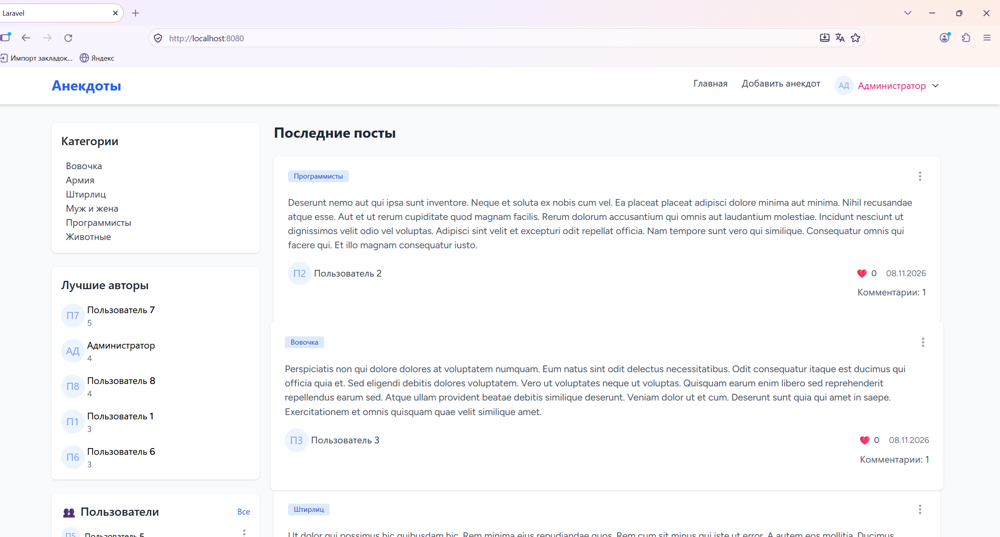
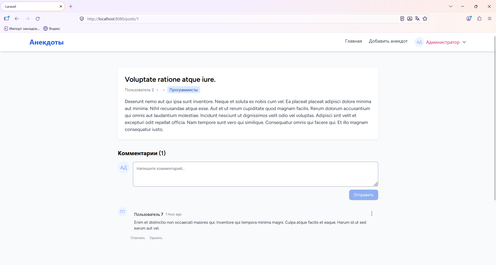
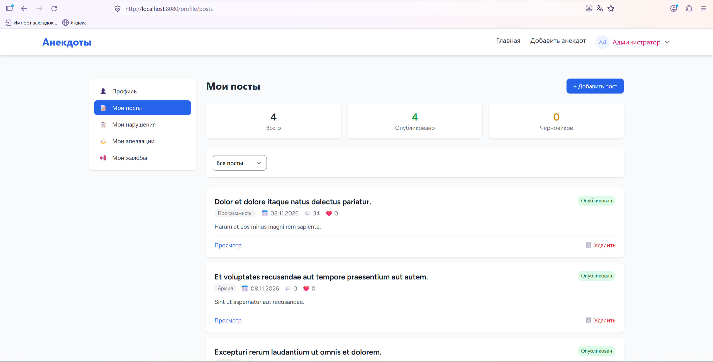
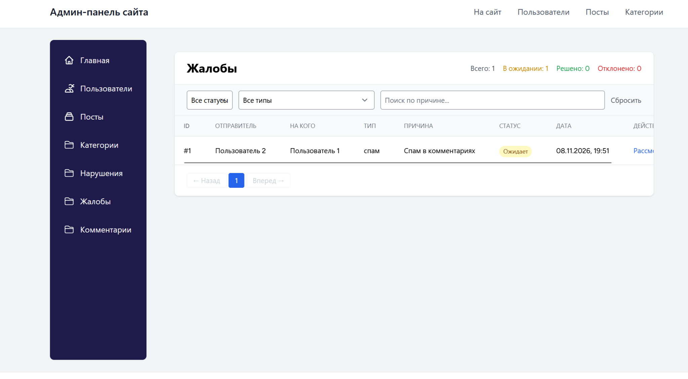
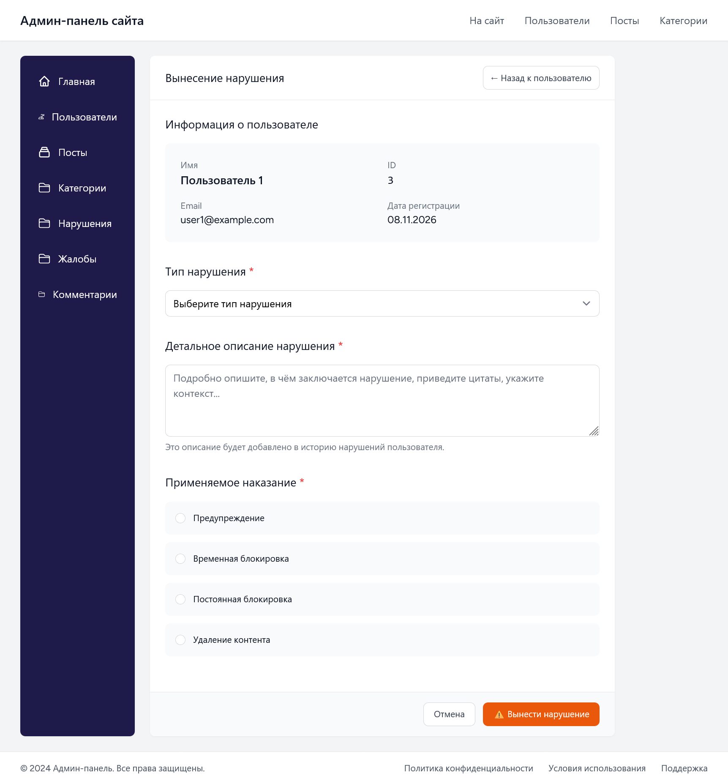
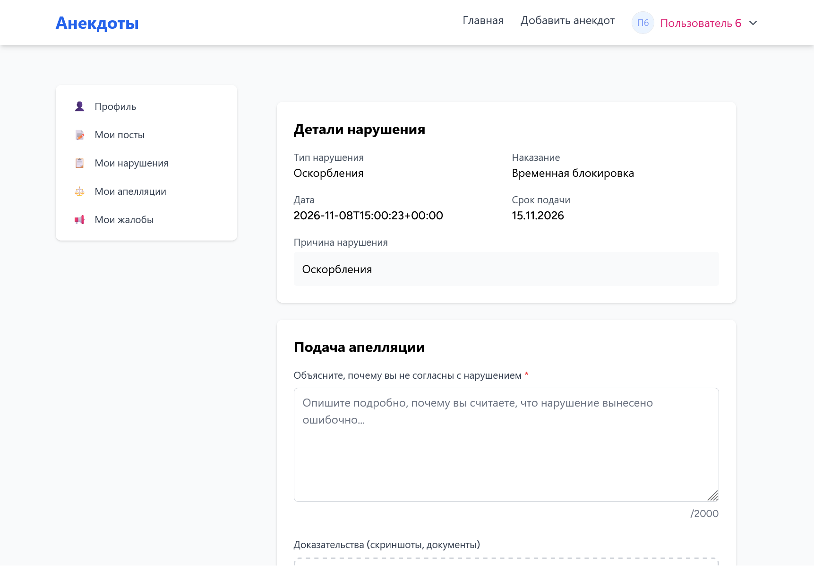

# 🎭 Анекдоты — блог с системой модерации

Полноценный блог для публикации анекдотов с развитой системой модерации: пользователи публикуют контент, оставляют комментарии и лайки, подают жалобы; администраторы выносят наказания, рассматривают жалобы и апелляции.

## 🚀 Стек технологий

**Backend:**
- PHP 8.2, Laravel 11, MySQL 8.0
- Laravel Notifications (email + БД), Policies, Form Requests, Service Layer
- Soft Deletes, транзакции

**Frontend:**
- Vue 3 + Inertia.js + Tailwind CSS
- Vite, Ziggy

**DevOps:**
- Docker + Docker Compose
- GitHub Actions (CI)
- PHPUnit (58 тестов)

---

## ✨ Возможности

### Для пользователей
- 🔐 Регистрация, вход, восстановление пароля
- 👤 Профиль, аватар, смена пароля, удаление аккаунта
- 📝 Создание и удаление своих постов
- 💬 Комментарии с вложенными ответами
- ❤️ Лайки постов
- 🚩 Жалобы на посты, комментарии и пользователей
- ⚖️ Подача апелляций на нарушения
- 📋 История своих нарушений и апелляций
- 🔔 Уведомления (email + БД)

### Для администраторов
- 👥 Управление пользователями (бан / разбан)
- 📂 Управление категориями
- 📄 Управление постами и комментариями
- ⚠️ Вынесение нарушений
- ⚖️ Рассмотрение апелляций
- 📢 Рассмотрение жалоб
- 📊 Дашборд со статистикой

---

## 📦 Быстрый старт

### Вариант 1: Docker (рекомендуется)

**Требования:** [Docker Desktop](https://www.docker.com/products/docker-desktop/) (или Docker + Docker Compose на Linux)

```bash
# 1. Клонировать репозиторий
git clone https://github.com/AnnaJane202/jokes.git
cd jokes

# 2. Скопировать .env
cp .env.example .env

# 3. Собрать и запустить контейнеры
docker compose up -d --build

# 4. Установить PHP-зависимости
docker compose exec app composer install

# 5. Сгенерировать ключ
docker compose exec app php artisan key:generate

# 6. Миграции + сидеры
docker compose exec app php artisan migrate:fresh --seed

# 7. Симлинк для storage
docker compose exec app php artisan storage:link
```

**Откройте:** **http://localhost:8080**

**Vite** (HMR) работает на `http://localhost:5173` — запускается автоматически в контейнере `node`.


### Что запускается

| Сервис | Контейнер | Порт на хосте |
|--------|-----------|---------------|
| Сайт (Nginx) | `jokes-nginx` | **8080** |
| PHP-FPM | `jokes-app` | 9000 (только внутри) |
| MySQL | `jokes-mysql` | **3307** (на хосте), 3306 (внутри) |
| Vite (Node) | `jokes-node` | 5173 |

**Полезные команды:**

```bash
# Логи
docker compose logs -f

# Зайти в контейнер
docker compose exec app bash

# Пересобрать
docker compose up -d --build --force-recreate

# Остановить
docker compose down

# Остановить и удалить данные БД
docker compose down -v
```

**Подключение к MySQL из IDE:**
- Host: `127.0.0.1`
- Port: **`3307`**
- Database: `jokes`
- User: `jokes`
- Password: `secret`

---

### Вариант 2: Локальная установка (без Docker)

**Требования:**
- PHP >= 8.2 (с расширениями `pdo_mysql`, `mbstring`, `gd`, `zip`, `exif`)
- Composer
- Node.js >= 20 + npm
- MySQL 8.0 / MariaDB 10.6+

```bash
# 1. Клонировать репозиторий
git clone https://github.com/AnnaJane202/jokes.git
cd jokes

# 2. Установить зависимости
composer install
npm install

# 3. Скопировать .env и сгенерировать ключ
cp .env.example .env
php artisan key:generate

# 4. ⚠️ ВАЖНО: отредактируйте .env под локальный MySQL
# Замените в .env:
#   DB_HOST=mysql  →  DB_HOST=127.0.0.1
#   DB_PASSWORD=secret  →  DB_PASSWORD=  (пусто)

# 5. Создать БД
mysql -u root -p -e "CREATE DATABASE jokes CHARACTER SET utf8mb4 COLLATE utf8mb4_unicode_ci;"

# 6. Миграции + сидеры
php artisan migrate:fresh --seed

# 7. Симлинк для storage
php artisan storage:link

# 8. Запустить Vite (в отдельном терминале)
npm run dev

# 9. Запустить сервер
php artisan serve
```

**Откройте:** `http://localhost:8000` (для локальной установки — стандартный порт Laravel).

---

## 🔑 Тестовые аккаунты

После `migrate:fresh --seed` создаются:

| Роль | Email | Пароль |
|------|-------|--------|
| 👑 Администратор | `admin@example.com` | `password` |
| 🛡️ Модератор | `moderator@example.com` | `password` |
| 👤 Пользователи | `user1@example.com` … `user10@example.com` | `password` |

Также создаются: 6 категорий, 30 постов, ~80 комментариев.

---

## 🏗 Архитектура

```
app/
├── Http/
│   ├── Controllers/
│   │   ├── Admin/           # админ-панель
│   │   └── Client/          # публичная часть
│   ├── Middleware/          # CheckBannedMiddleware
│   ├── Requests/            # Form Requests
│   └── Resources/           # API Resources
├── Models/
├── Policies/                # PostPolicy, CommentPolicy
├── Services/                # бизнес-логика
│   ├── ViolationService.php
│   ├── ReportResolutionService.php
│   ├── CommentService.php
│   └── PostService.php
├── Notifications/           # email + БД, ShouldQueue
├── Events/                  # NewReportEvent
├── Listeners/               # SendReportNotification
├── Traits/                  # HasViolationTypes
└── Console/Commands/        # cron-задачи

database/
├── factories/               # фабрики моделей
├── migrations/
└── seeders/
```

### Ключевые архитектурные решения

- **Service Layer** — бизнес-логика в сервисах (`ViolationService`, `ReportResolutionService`). Контроллеры тонкие.
- **Form Requests** — валидация вне контроллеров.
- **Policies** — контроль доступа (`PostPolicy` для удаления/редактирования).
- **Notifications с ShouldQueue** — асинхронная отправка email.
- **Soft Deletes** — восстановление удалённых записей.
- **CheckBannedMiddleware** — блокирует забаненных, но оставляет доступ к странице бана и подаче апелляции.
- **Транзакции** — операции с наказаниями в `DB::transaction`.

---

## 🧪 Тесты

```bash
# В Docker
docker compose exec app php artisan test

# Локально
php artisan test
```

**Покрытие:** 58 тестов, 133 assertions.

---

## 🐳 Docker: подробности

### Файлы

- `Dockerfile` — PHP 8.2-FPM + расширения
- `docker-compose.yml` — 4 сервиса (app, nginx, mysql, node)
- `docker/nginx/default.conf` — конфиг Nginx
- `.env.example` — шаблон `.env` для Docker

### Переменные окружения (Docker)

| Переменная | Значение | Описание |
|-----------|----------|----------|
| `APP_URL` | `http://localhost:8080` | Публичный URL |
| `DB_HOST` | `mysql` | Имя контейнера БД |
| `DB_PORT` | `3306` | Порт **внутри** сети Docker |
| `DB_DATABASE` | `jokes` | Имя БД |
| `DB_USERNAME` | `jokes` | Пользователь БД |
| `DB_PASSWORD` | `secret` | Пароль БД |

### Если порт 8080 занят

Измените в `docker-compose.yml`:

```yaml
nginx:
    ports:
        - "8081:80"   # было 8080:80
```

И в `.env`:
```
APP_URL=http://localhost:8081
```

### Если MySQL не стартует

```bash
docker compose down -v    # удалить volume БД
docker compose up -d
docker compose exec app php artisan migrate:fresh --seed
```

### Vite HMR не работает

В `vite.config.js` должно быть:

```javascript
import { defineConfig } from 'vite';
import laravel from 'laravel-vite-plugin';
import vue from '@vitejs/plugin-vue';

export default defineConfig({
    plugins: [
        laravel({
            input: ['resources/css/app.css', 'resources/js/app.js'],
            refresh: true,
        }),
        vue(),
    ],
    server: {
        host: '0.0.0.0',
        port: 5173,
        strictPort: true,
        hmr: {
            host: 'localhost',
        },
    },
});
```

---

## 🔔 Настройка уведомлений

### Email

В `.env`:

```env
MAIL_MAILER=log
# или SMTP:
# MAIL_MAILER=smtp
# MAIL_HOST=smtp.mailtrap.io
# MAIL_PORT=2525
# MAIL_USERNAME=...
# MAIL_PASSWORD=...
```

При `MAIL_MAILER=log` письма пишутся в `storage/logs/laravel.log`.

### Очереди

```bash
# В Docker
docker compose exec app php artisan queue:work

# Локально
php artisan queue:work
```

---

## 🔧 Полезные команды

```bash
# Очистить всё
php artisan optimize:clear

# Список маршрутов
php artisan route:list

# Пересоздать БД
php artisan migrate:fresh --seed

# Сгенерировать Ziggy (после изменения маршрутов)
php artisan ziggy:generate
```

---

## 📸 Скриншоты

### Главная страница


### Пост с комментариями


### Личный кабинет


### Админ-панель — жалобы


### Форма вынесения нарушения


### Апелляция


---

## 🚦 CI/CD

Проект использует **GitHub Actions** для автоматического прогона тестов.

Статус сборки: 

Workflow:
1. PHP 8.2 + нужные расширения (включая `pdo_sqlite`)
2. `composer install`
3. `cp .env.example .env` + `php artisan key:generate`
4. `php artisan test` (на SQLite `:memory:`, через `phpunit.xml`)

---

## 🗺 Roadmap

- [ ] REST API для мобильного приложения
- [ ] WebSockets для уведомлений в реальном времени
- [ ] Полнотекстовый поиск (Meilisearch / Scout)
- [ ] Экспорт статистики в PDF
- [ ] Тёмная тема
- [ ] Многоязычность (i18n)

---

## 📄 Лицензия

MIT License.

---

## 👤 Автор

- GitHub: [@AnnaJane202](https://github.com/AnnaJane202)

---

## 🙏 Благодарности

[Laravel](https://laravel.com) • [Inertia.js](https://inertiajs.com) • [Vue.js](https://vuejs.org) • [Tailwind CSS](https://tailwindcss.com)
